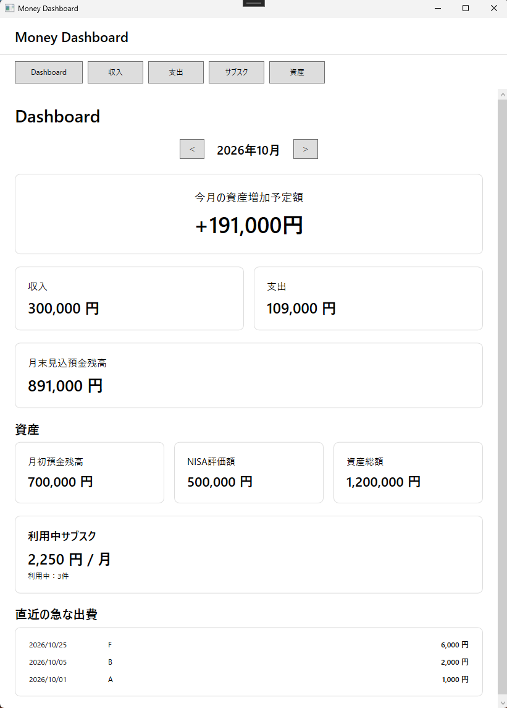
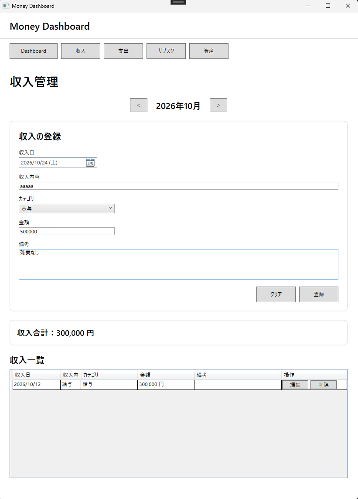
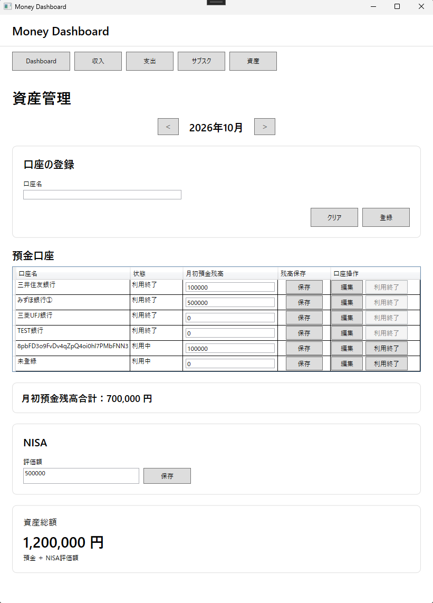

# Money Dashboard

Windows向けの家計・資産管理デスクトップアプリです。  
収入・支出・サブスクリプション・預金・NISAをまとめて管理し、月ごとの収支や資産状況をDashboardで確認できます。

## 主な機能

- Dashboard
  - 月ごとの収入・支出集計
  - 資産増加予定額
  - 月初預金残高
  - 月末見込預金残高
  - NISA評価額
  - 資産総額
  - 利用中サブスクの月額換算合計・件数
  - 直近の急な出費（最大5件）
- 収入管理
  - 登録・一覧表示・編集・削除
  - 月別表示
  - カテゴリ管理
- 支出管理
  - 登録・一覧表示・編集・削除
  - 月別表示
  - 「通常 / 急な出費」の区分
- サブスク管理
  - 月払い / 年払い
  - 年払いの月額換算
  - 利用中 / 停止中 / 解約済み
  - 利用中サブスクのみ集計
- 資産管理
  - 預金口座の登録・口座名変更・利用終了
  - 月ごとの月初預金残高
  - 月ごとのNISA評価額
  - 預金合計・資産総額の算出

## 技術スタック

- C#
- WPF
- .NET 10
- SQLite
- Dapper
- CommunityToolkit.Mvvm
- Microsoft.Extensions.DependencyInjection
- Microsoft.Extensions.Logging
- Serilog
- Visual Studio 2026

## アーキテクチャ

MVVMをベースに、役割ごとにプロジェクトを分割しています。

```text
View (WPF / XAML)
    ↓ Binding / Command
ViewModel
    ↓
Application Service
    ↓
Repository Interface
    ↓
Repository Implementation
    ↓
Dapper / Microsoft.Data.Sqlite
    ↓
SQLite
```

### ソリューション構成

```text
MoneyDashboard
├─ MoneyDashboard.App
│  ├─ Views
│  ├─ ViewModels
│  ├─ Converters
│  ├─ Behaviors
│  └─ Services
├─ MoneyDashboard.Core
│  ├─ Models
│  ├─ Enums
│  ├─ Services
│  └─ Repositories
├─ MoneyDashboard.Infrastructure
│  ├─ Database
│  └─ Repositories
└─ MoneyDashboard.Tests
```

## 主な設計上のポイント

### 月初預金残高

預金残高は月ごとに保存します。

```text
2026-09 → 950,000円
2026-10 → 1,000,000円
2026-11 → 1,080,000円
```

`0円` と `未登録` は別の状態として扱います。

### 資産総額

```text
資産総額 = 月初預金残高 + NISA評価額
```

必要な値が未登録の場合は「未算出」として扱います。

### 資産増加予定額

```text
資産増加予定額 = 対象月の収入合計 - 対象月の支出合計
```

NISAの評価損益は含めません。

### サブスク

年払いの場合は実際の契約金額を保存し、表示・集計時に12か月で割って月額換算します。

```text
年額 12,000円
→ 月額換算 1,000円
```

停止中・解約済みのサブスクは利用中合計に含めません。

## データ保存先

SQLiteデータベースとログはユーザーごとのローカル領域に保存します。

```text
%LOCALAPPDATA%\MoneyDashboard\moneydashboard.db
%LOCALAPPDATA%\MoneyDashboard\logs
```

Gitリポジトリ内にはDBファイルやログを保存しません。

## 起動方法

### 必要環境

- Windows
- .NET 10 SDK
- Visual Studio 2026 または .NET 10 / WPF を扱える開発環境

### 手順

1. リポジトリをクローンします。

```bash
git clone <repository-url>
```

2. `MoneyDashboard.slnx` を開きます。
3. NuGetパッケージを復元します。
4. `MoneyDashboard.App` をスタートアッププロジェクトに設定します。
5. ビルドして起動します。

初回起動時にSQLiteデータベースと初期カテゴリが自動作成されます。

## 動作確認

以下の主要機能について手動で動作確認を実施しています。

- 収入・支出・サブスクの登録 / 編集 / 削除
- 口座登録・口座名変更・利用終了
- 月初預金残高・NISA評価額の保存
- Dashboard集計
- 編集中の画面遷移制御
- 数値入力制御
- アプリ再起動後のデータ保持
- ログ出力

## スクリーンショット

### Dashboard



### 収入管理



### 資産管理




## 開発目的

要件定義・基本設計・詳細設計・実装まで、業務システム開発に近い工程を個人開発で経験することを目的として作成しました。

単純な家計簿ではなく、月ごとの収支と預金・NISAをまとめて確認できる「資産形成ダッシュボード」を意識しています。

## 今後の拡張候補

- 資産推移グラフ
- 前月比較
- CSV入出力
- バックアップ
- 資産目標管理
- ダークモード
